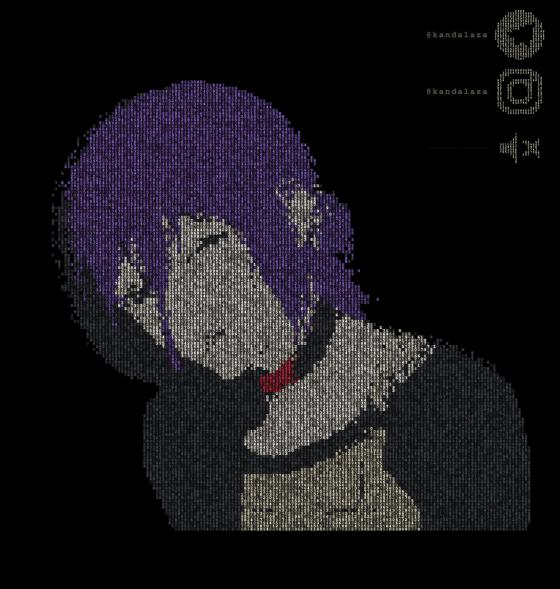

<div align="center">

# ◈ Reze · digit portrait

**An anime girl sculpted from falling digits — zero images, zero canvas libraries, pure 0–9.**



[](index.html)
[](index.html)
[](index.html)
[](index.html)
[](LICENSE)

</div>

---

## What is this?

**Reze** is a self-contained webpage that replays a 222-frame animated portrait of an anime girl — built *entirely* from a rain of falling digits (0–9). There are no images, no sprites, no SVG shapes. The silhouette and all zone colors emerge purely from the position and color of individual glyphs rendered on a `<canvas>`.

Each frame comes from a real video, processed frame-by-frame with Apple's Vision framework and a 5-zone color classifier. The result is encoded as a compact RLE string embedded directly in the HTML — open the file anywhere, offline, and it plays.

---

## How to run

```bash
# just open it
open index.html
```

That's it. No server, no build step, no npm install. One file → works everywhere.

---

## How it works

```
Video frames  →  Vision mask  →  5-zone classifier  →  173×150 grid  →  RLE string
                (foreground)    (hair / skin / apron             embedded in HTML
                                 sweater / choker / bg)
```

### Zone colors

| Zone | Color | Hex |
|------|-------|-----|
| 💜 Hair | purple | `#8a5fc2` |
| 🩶 Skin | warm ivory | `#f1e6da` |
| 🩷 Sweater | charcoal | `#45474f` |
| 🤍 Apron | beige | `#cfc6ae` |
| ❤️ Choker | crimson | `#ff2d55` |
| ⬛ Background | black | `#000000` |

### Rendering pipeline

1. **Glyph atlas** — all digits 0–9 are pre-rendered for every zone × brightness level into an offscreen canvas. Each cell is drawn with `drawImage`, the fastest Canvas 2D path.
2. **Digit rain** — every column falls at a deterministic speed derived from `hash2(x, y)`. Brightness fades along the column.
3. **Frame decode** — per tick, the current RLE frame is decoded and every cell's zone is looked up. The cell's digit + brightness + zone together select the pre-rendered glyph.
4. **Corner widget** — the TG and Instagram icons, the volume slider icon, and the `@kandalaza` nicknames are all *also* drawn from digits using the same atlas pipeline.

### Encoding

Custom RLE over a ~85-char printable ASCII alphabet (no `\`, `'`, `"`, `` ` ``, `<`, `>`, `&`, `$`). Runs ≤ 13 cells: one byte. Longer runs: three bytes. 222 frames × 173×150 cells compress to ~450 KB total.

---

## Features

- **Single HTML file** — embed it anywhere; share it as a link or attachment
- **Zero dependencies** — vanilla JS, standard Canvas 2D API, nothing else
- **Faithful silhouette** — shape comes from per-frame segmentation masks, not random digit positions
- **Temporal smoothing** — 3-frame median filter kills flickering zone transitions
- **Embedded audio** — background piano track plays in a `<audio loop>` element (base64 data-URI)
- **Volume control** — digit-rendered speaker icon + slider, volume persists via `localStorage`
- **Social widget** — floating TG + Instagram corner icons link to `@kandalaza`
- **30 fps loop** — silky playback via `requestAnimationFrame`

---

## Tech stack

| Layer | What |
|-------|------|
| Frame extraction | Swift + AVFoundation |
| Segmentation | Apple Vision `VNGenerateForegroundInstanceMaskRequest` |
| Zone classification | Python + NumPy + Pillow (HSV hair, geometry-based apron, choker band scan) |
| Encoding | Custom RLE + printable-ASCII alphabet |
| Rendering | HTML5 Canvas 2D, glyph atlas, `requestAnimationFrame` |
| Audio | AAC mono, embedded as `data:audio/mp4;base64,...` |

---

## Project structure

```
Reze/
└── index.html   # the entire project — open and enjoy
```

---

## Credits

Portrait character: **Reze** from *Chainsaw Man*  
Art direction, code & music curation: [@kandalaza](https://t.me/kandalaza)

---

<div align="center">

Made with digits. Every single one.

⭐ If this made you smile, leave a star.

</div>
